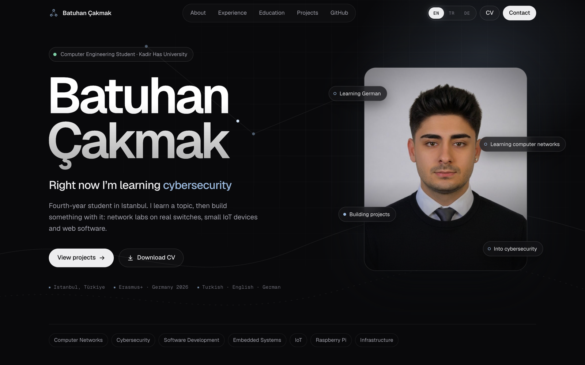
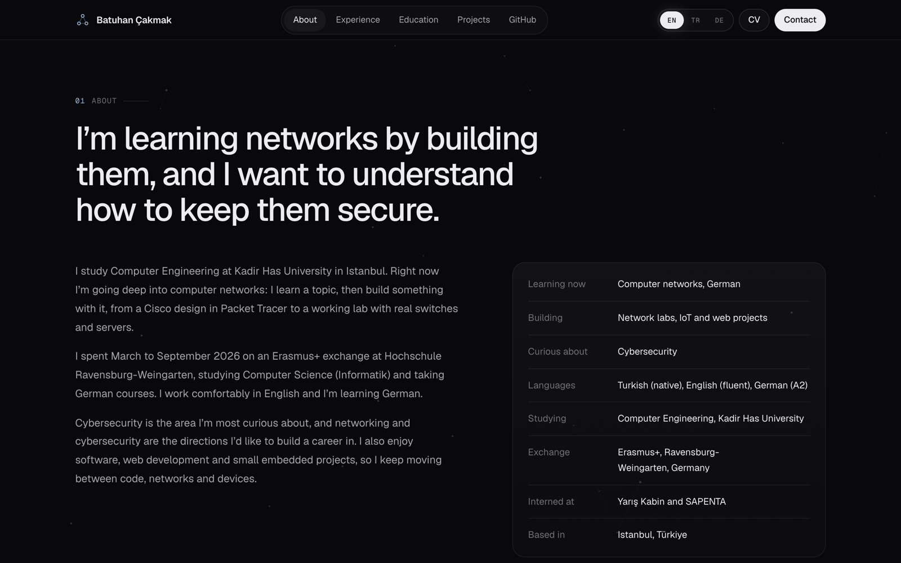
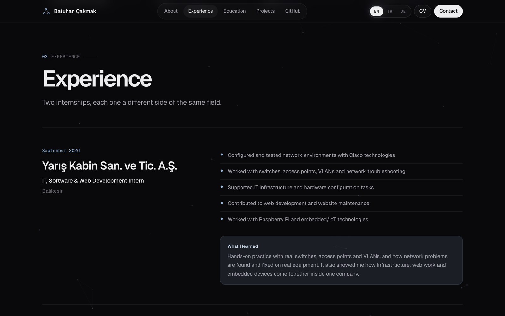
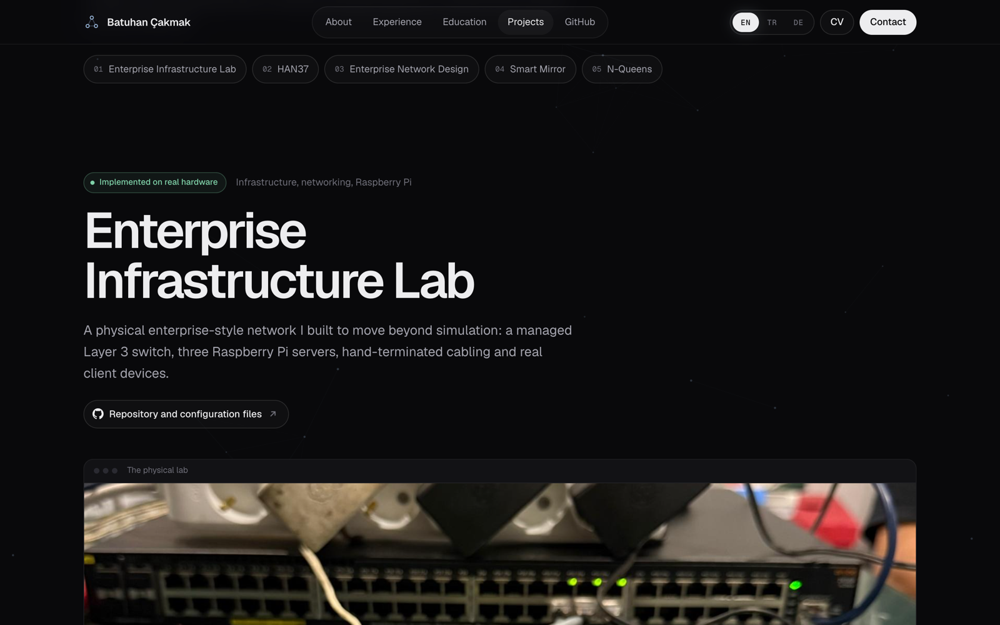
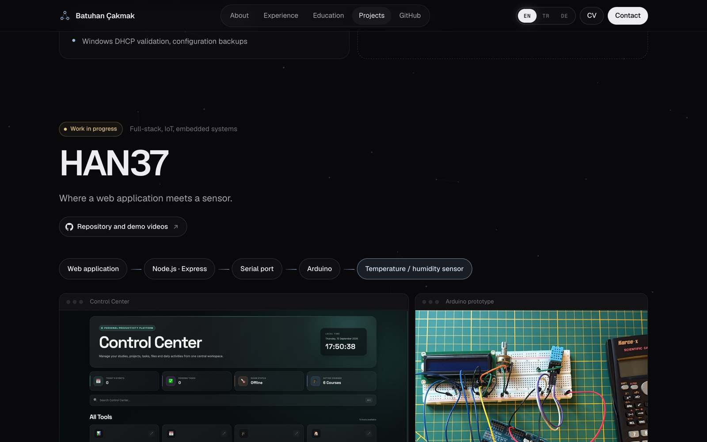
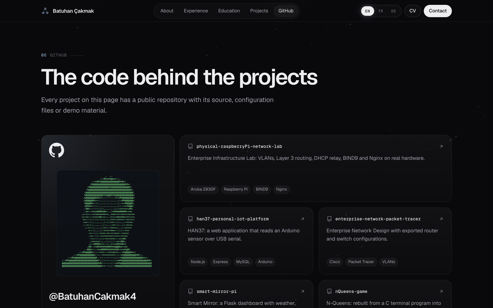
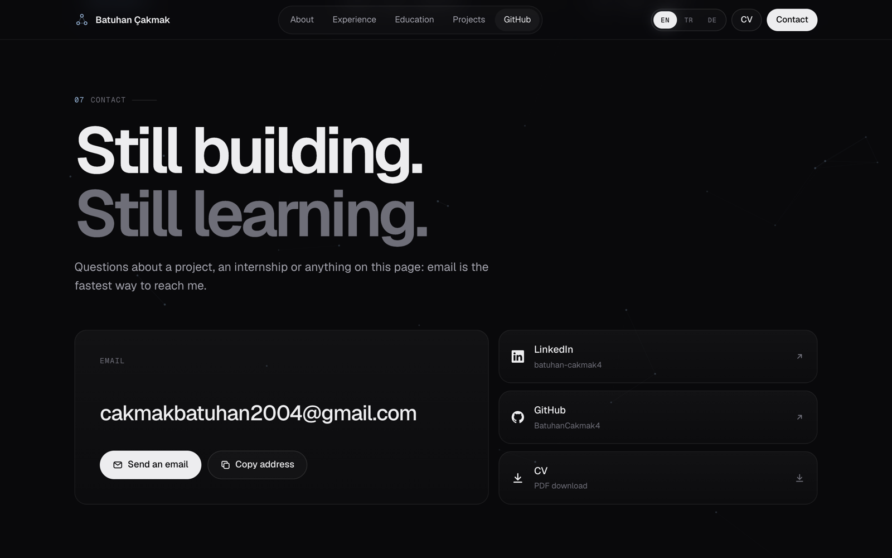
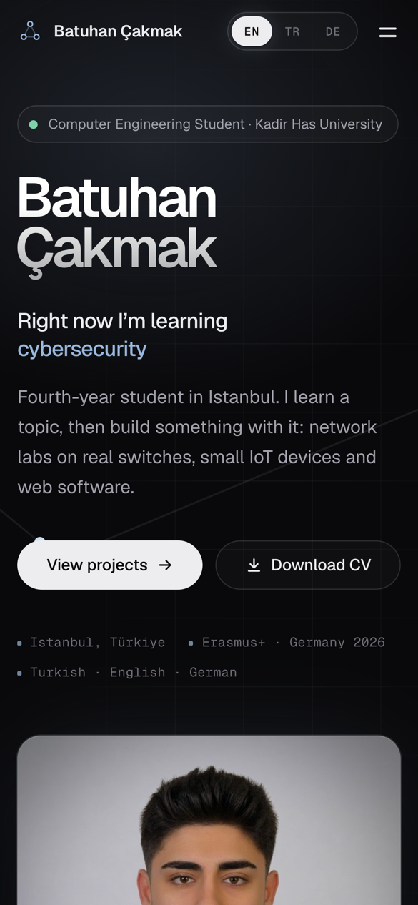

<div align="center">

# Batuhan Çakmak · Portfolio

Personal portfolio of a Computer Engineering student at Kadir Has University, focused on computer networks, cybersecurity, IoT and software.

Hand-written HTML, CSS and JavaScript with no framework and no build step, served by a hardened Node server that has **zero npm dependencies**.




</div>

## About the project

The site is a single page that covers who I am, what I work with, my internships, my education, the projects I've built and where to reach me. The goal was a page that is fast, accessible and easy to host, with nothing to install and no third-party code running on the server.

### Features

- **Three languages:** English, Turkish and German. The language is picked from the saved choice or the browser, and translation runs before first paint, so the page never flashes the wrong language.
- **Motion that stays out of the way:** an intro logo loader, staggered scroll reveals and a faint network background that only moves while you scroll. All of it respects `prefers-reduced-motion`.
- **Responsive:** built mobile-first, with a separate mobile menu and layouts that hold up from phones to wide screens.
- **Accessible:** semantic sections, a skip link, visible focus states, labelled navigation and the active section highlighted in the nav.
- **Works without JavaScript:** if a script fails to load, the content still shows.
- **Small attack surface:** no forms, no database and no user input on the backend.

## Screenshots

<table>
  <tr>
    <td width="50%"><p align="center"><sub>About</sub></p></td>
    <td width="50%"><p align="center"><sub>Experience</sub></p></td>
  </tr>
  <tr>
    <td width="50%"><p align="center"><sub>Project: Enterprise Infrastructure Lab</sub></p></td>
    <td width="50%"><p align="center"><sub>Project: HAN37</sub></p></td>
  </tr>
  <tr>
    <td width="50%"><p align="center"><sub>GitHub repositories</sub></p></td>
    <td width="50%"><p align="center"><sub>Contact</sub></p></td>
  </tr>
</table>

<p align="center">
  <br>
  <sub>Mobile</sub>
</p>

## Featured projects

| Project | What it is |
| --- | --- |
| [Enterprise Infrastructure Lab](https://github.com/BatuhanCakmak4/physical-raspberryPi-network-lab) | A physical enterprise-style network: Layer 3 switch, VLANs, DHCP relay, BIND9 and Nginx on three Raspberry Pi servers, hand-terminated cabling. |
| [HAN37](https://github.com/BatuhanCakmak4/han37-personal-iot-platform) | A Node.js / Express web app that reads an Arduino temperature and humidity sensor over USB serial. |
| [Enterprise Network Design](https://github.com/BatuhanCakmak4/enterprise-network-packet-tracer) | A Cisco Packet Tracer design with exported router and switch configurations. |
| [Smart Mirror](https://github.com/BatuhanCakmak4/smart-mirror-pi) | A Flask dashboard on a Raspberry Pi with weather, Spotify and calendar. |
| [N-Queens](https://github.com/BatuhanCakmak4/nQueens-game) | A C terminal program rebuilt as a C++ desktop game. |

## Tech stack

| Layer | Choice |
| --- | --- |
| Markup and styles | Plain HTML and CSS (custom properties, `clamp()` based fluid spacing, no framework) |
| Scripts | Vanilla JavaScript split into small files: `boot.js`, `i18n.js`, `main.js`, `bg.js` |
| Fonts | Geist and Geist Mono from Google Fonts |
| Server | Node.js core modules only (`http`, `fs`, `zlib`), no `npm install` needed |
| Deployment | Docker image based on `node:20-alpine`, with a health check |

## Project structure

```
server.js              hardened static server (no npm packages)
package.json
Dockerfile
.env.example           configuration template
docs/screenshots/      images used in this README
public/
  index.html           the page
  404.html
  css/style.css        all styles
  js/boot.js           runs first: language choice, intro loader, no-JS fallback
  js/i18n.js           English / Turkish / German translations
  js/main.js           navigation, scroll reveals and interactions
  js/bg.js             scroll-linked network background
  assets/              portrait, CV (PDF), favicons
  images/              project screenshots and photos
  robots.txt
  .well-known/security.txt
```

## Running locally

Requires Node.js 18 or newer. There is nothing to install.

```bash
node server.js                  # http://localhost:3000
node --env-file=.env server.js  # with a .env file (Node 20.6+)
```

Or with npm scripts: `npm start` / `npm run start:env`.

### Configuration

Copy `.env.example` to `.env` and adjust as needed:

| Variable | Default | Purpose |
| --- | --- | --- |
| `PORT` | `3000` | Port to listen on |
| `HOST` | `0.0.0.0` | Interface to bind |
| `TRUST_PROXY` | `0` | Number of reverse proxies in front of Node |
| `RATE_LIMIT_MAX` | `240` | Requests allowed per IP per minute |
| `ALLOWED_HOSTS` | empty (any) | Comma-separated hostnames the site answers to |

## Security

- Strict Content-Security-Policy: no inline scripts or styles, only the site's own files and Google Fonts.
- HSTS and `upgrade-insecure-requests` are sent only on HTTPS requests.
- `X-Content-Type-Options`, `X-Frame-Options: DENY`, `Referrer-Policy`, `Permissions-Policy`, COOP and CORP headers.
- Path traversal protection, dotfiles blocked (except `/.well-known`), an allowlist of file extensions and no directory listing.
- Only `GET`, `HEAD` and `OPTIONS`; anything else gets `405`.
- Per-IP rate limiting that answers `429` when exceeded.
- URL length limit, header and request timeouts, host validation through `ALLOWED_HOSTS`.
- ETag and `304` responses, Brotli/gzip compression, JSON line access logs, a `/healthz` endpoint and graceful shutdown on `SIGTERM`.

## Deployment

With Docker:

```bash
docker build -t portfolio .
docker run -d -p 3000:3000 --restart unless-stopped portfolio
```

Put Caddy or nginx in front to terminate HTTPS, then set `TRUST_PROXY=1` and `ALLOWED_HOSTS=yourdomain.com,www.yourdomain.com`.

For a static host such as Netlify or Cloudflare Pages, upload the `public/` folder and add the security headers above in that service's settings.

## Notes

- Project images live in `public/images/`. File names must match the ones referenced in `index.html` exactly, including case. If a file is missing, the page doesn't break; that frame just stays empty with its caption.
- To update the CV, replace `public/assets/BATUHAN_CAKMAK_CV.pdf` with a file of the same name.
- To serve fonts yourself, put them in `public/assets/fonts` and remove Google from the `style-src` and `font-src` rules.
- Still to add once there is a domain: `<link rel="canonical">`, `sitemap.xml`, `og:image` and `og:url`.

## Contact

- Email: [cakmakbatuhan2004@gmail.com](mailto:cakmakbatuhan2004@gmail.com)
- LinkedIn: [batuhan-cakmak4](https://www.linkedin.com/in/batuhan-cakmak4)
- GitHub: [@BatuhanCakmak4](https://github.com/BatuhanCakmak4)
